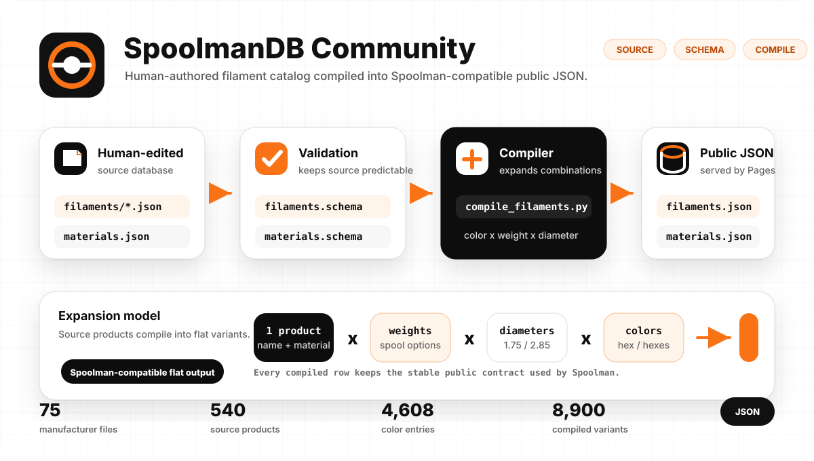
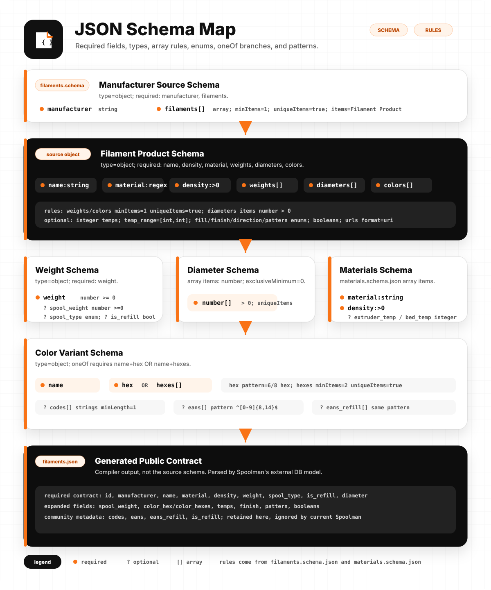
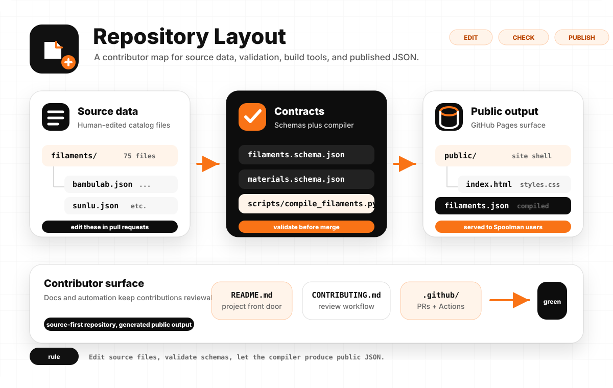

# Data and contributor reference

[README](../README.md) · [Maintenance](maintenance.md) · [Compatibility](UPSTREAM_COMPATIBILITY.md)

### Spoolman compatibility contract

`spool_type` in the published `filaments.json` describes physical spool material and is restricted to the values accepted by Spoolman. Community-only refill metadata is emitted as the additional boolean `is_refill`. The public Community JSON and Explorer retain that distinction; current Spoolman accepts the extra field but drops it when serializing data into its own cache.

| Source weight metadata | Published `spool_type` | Published `is_refill` |
| --- | --- | ---: |
| `plastic`, `cardboard`, or `metal` | same value | `false` |
| legacy `refill` or `is_refill: true` | `null` | `true` |
| legacy `unknow`, `null`, or omitted | `null` | `false` |

Compatibility is checked in three layers:

1. Compiler normalization uses an explicit allowlist and preserves historical ID suffixes.
2. The compiled schema rejects values outside Spoolman's public enum.
3. Normal builds validate every record against a **required stable pin** of Spoolman's `ExternalFilament` contract. Version and commit are defined only in [`contracts/spoolman_upstream.json`](../contracts/spoolman_upstream.json). CI uses the reviewed offline snapshot [`contracts/spoolman_externaldb.py`](../contracts/spoolman_externaldb.py) so merge checks are deterministic and network-free. Details: [docs/spoolman-compatibility.md](spoolman-compatibility.md).

A separate **canary** check fetches current `Donkie/Spoolman:master`, validates against it, and reports exactly which `ExternalFilament` fields or types changed relative to the stable pin. Canary failures are visible in CI (job summary + warning) but **do not block data PRs**. The weekly [Spoolman compatibility workflow](../.github/workflows/spoolman-compatibility.yml) also runs **pin integrity** (`--mode verify-pin`): it fetches the configured stable commit and asserts the local snapshot still matches, without changing offline PR CI.

## Data model at a glance

<picture>
  <source media="(prefers-color-scheme: dark)" srcset="assets/data-model-dark.svg">
  
</picture>

Source files stay small enough to review by hand. The compiler validates and expands them into the flat JSON contract consumed by Spoolman.

### JSON schema map

<picture>
  <source media="(prefers-color-scheme: dark)" srcset="assets/json-structure-dark.svg">
  
</picture>

## Repository layout

```text
filaments/                 Manufacturer source JSON files
materials.json             Shared material defaults
filaments.schema.json      Schema for manufacturer source files
materials.schema.json      Schema for material defaults
scripts/
  compile_filaments.py      Compile source data into public JSON
  readme_snapshot.py        Generate/check README repository metrics
  asean_manufacturers.json  Curated ASEAN brand-location registry
public/                    GitHub Pages shell and deployed data target
```

<picture>
  <source media="(prefers-color-scheme: dark)" srcset="assets/repository-layout-dark.svg">
  
</picture>

## Contributor workflow

1. Add or edit manufacturer source files in `filaments/`.
2. Keep the pull request focused: one manufacturer, one correction set, or one schema change.
3. Link manufacturer product pages, datasheets, SDS/TDS files, or other evidence.
4. Run validation and tests locally before opening a pull request.

First install developer dependencies:

```powershell
pip install -r requirements-dev.txt
```

Then compile, validate, and test:

```powershell
python scripts/readme_snapshot.py --write
python scripts/compile_filaments.py
python scripts/validate.py
python -m pytest -q
python scripts/check_spoolman_compat.py --mode stable
# Optional advisory check against Donkie/Spoolman master (does not block merge):
python scripts/check_spoolman_compat.py --mode canary
```

## Data model

The source files in `filaments/` are intentionally compact. Deployment expands them into one generated `filaments.json` file. If a source entry has two diameters, two spool weights, and five colors, it becomes twenty compiled filament variants.

<details>
<summary>Filament source fields</summary>

| Field | Required | Notes |
| --- | --- | --- |
| `name` | yes | Product or product-line name. Usually contains `{color_name}` so each color expands into a readable compiled name. Follow manufacturer naming; do not add `material` here unless it is part of the official product name. |
| `material` | yes | Authoritative material code, such as `PLA`, `PETG`, `ABS`, `TPU-95A`, or schema-supported composites. |
| `density` | yes | Material density in g/cm3. |
| `weights` | yes | Array of `weight`, optional `spool_weight`, optional physical `spool_type`, and optional `is_refill`. Prefer `is_refill: true` for spoolless products; legacy `spool_type: "refill"` remains accepted for ID stability. |
| `diameters` | yes | Filament diameters in mm, commonly `1.75` or `2.85`. |
| `colors` | yes | Color objects with `name` plus either `hex` or `hexes`. |
| `extruder_temp` | optional | Recommended extruder temperature in degrees Celsius. |
| `extruder_temp_range` | optional | Two-value temperature range, such as `[190, 230]`. |
| `bed_temp` | optional | Recommended bed temperature in degrees Celsius. |
| `bed_temp_range` | optional | Two-value bed temperature range. |
| `finish` | optional | `matte` or `glossy`; only set when the product is designed that way. |
| `multi_color_direction` | optional | `coaxial` for split/side-by-side colors or `longitudinal` for color changes along the filament length. |
| `pattern` | optional | Currently `marble` or `sparkle`. |
| `translucent` | optional | Boolean for partially see-through filament. |
| `glow` | optional | Boolean for glow-in-the-dark filament. |
| `country_of_origin` | optional | Manufacturing country as ISO 3166-1 alpha-2 (`US`, `CN`, `DE`, …). Full names and non-ISO strings are rejected. |
| `sds_url` | optional | Safety Data Sheet URL. |
| `tds_url` | optional | Technical Data Sheet URL. |

Color entries can override `finish`, `multi_color_direction`, `pattern`, `translucent`, and `glow` when a specific color differs from the product default. They can also include `codes`, `eans`, and `eans_refill` arrays for manufacturer product codes, SKUs, or platform variant IDs and spooled/refill EAN or GTIN barcodes.

### Display names and upstream compatibility

Compiled `name` values stay upstream-compatible with [Donkie/SpoolmanDB](https://github.com/Donkie/SpoolmanDB): the compiler expands the source template and color only. `material` remains a separate field.

The Community Explorer may compose `material + name` for display and search when the product name does not already contain the material as its own token. For example, `name: "Plus BLACK"` with `material: "ABS"` is stored as-is in `filaments.json`, while Explorer shows `ABS Plus BLACK`.

`python scripts/validate.py` prints non-blocking `WARN display-name` hints for ambiguous templates. Use `--strict-display-names` only when you want that check to fail validation.

</details>

<details>
<summary>Material source fields</summary>

All shared material defaults live in `materials.json`.

| Field | Required | Notes |
| --- | --- | --- |
| `material` | yes | Material name, such as `PLA`. |
| `density` | yes | Density in g/cm3. |
| `extruder_temp` | optional | General extruder temperature. |
| `bed_temp` | optional | General bed temperature. |

</details>
